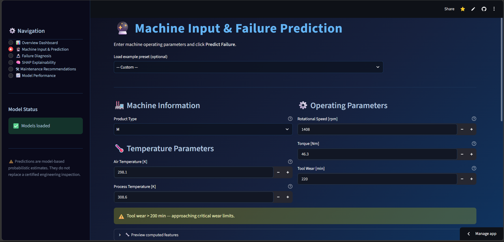
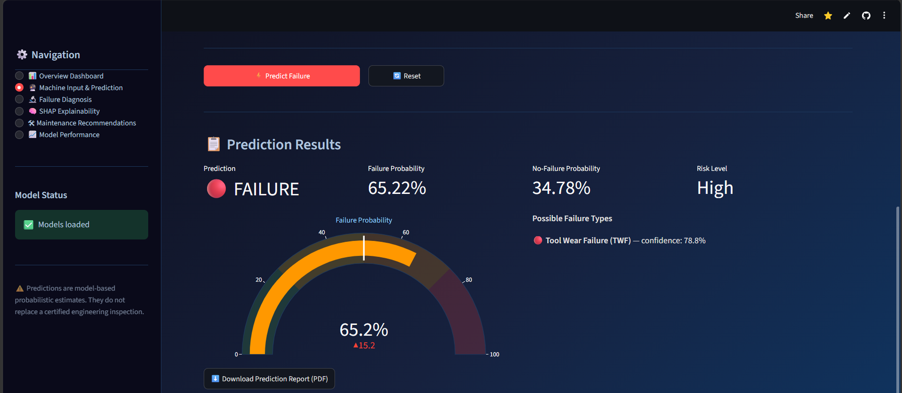
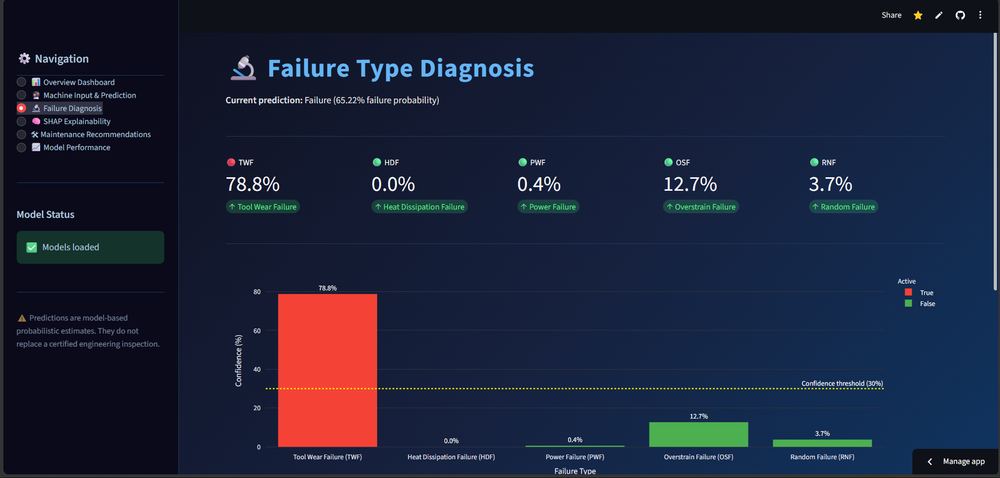
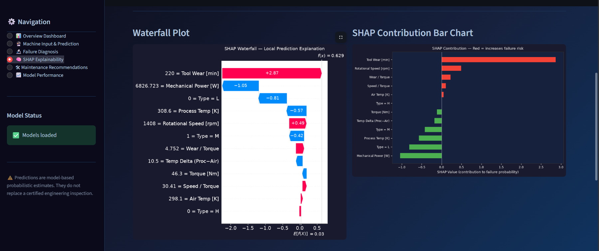
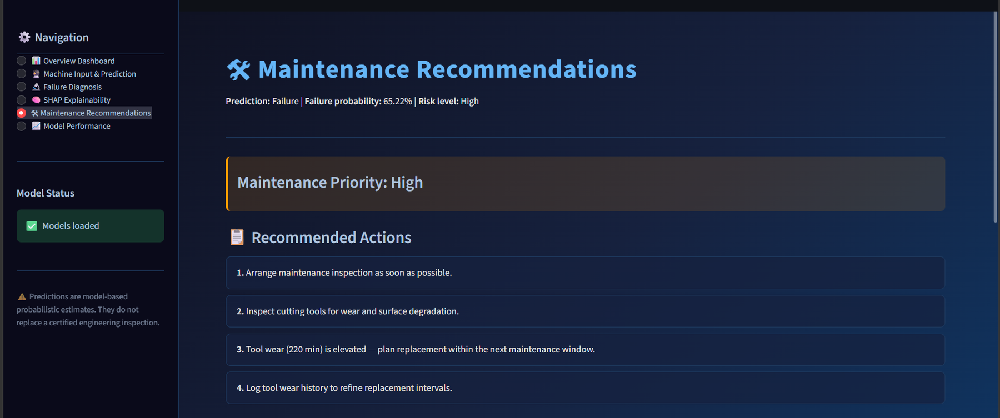
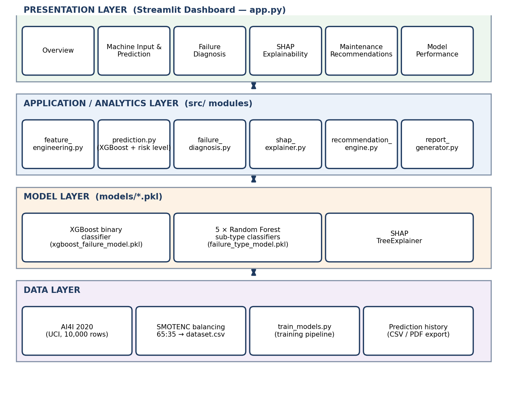
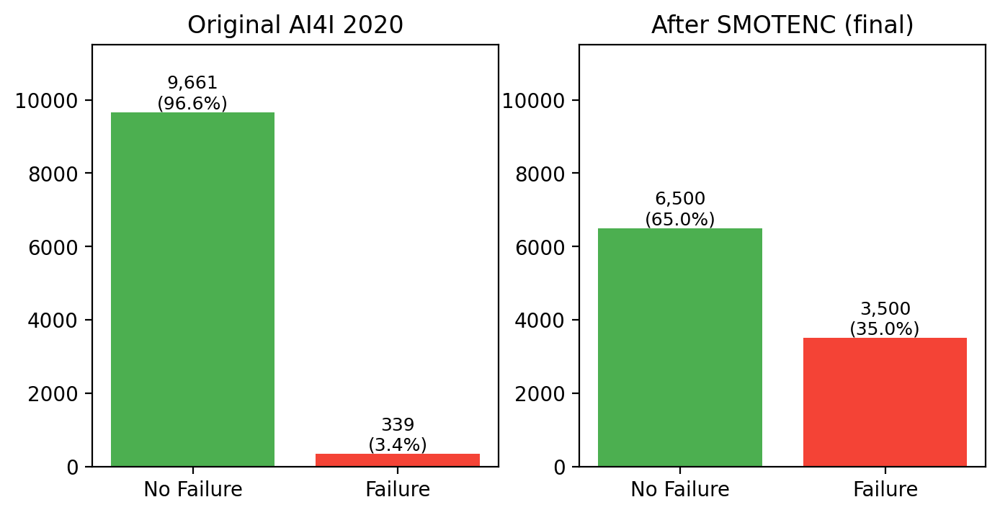
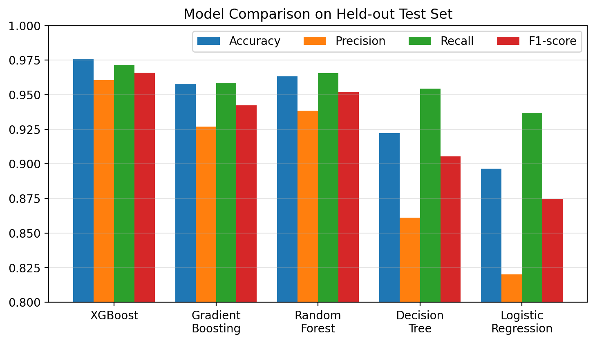
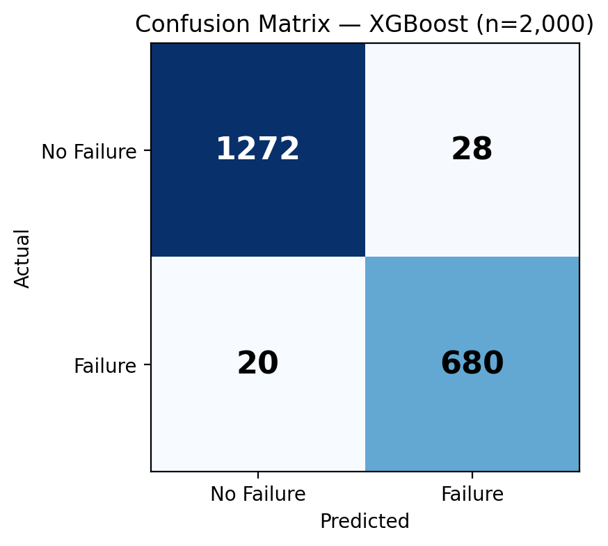

# AI-Based Industrial Predictive Maintenance & Failure Diagnosis System

An AI-powered Streamlit application for industrial machine failure prediction, failure-type diagnosis, SHAP explainability, and maintenance recommendations. Built using the **AI4I 2020 Predictive Maintenance Dataset**.

<p align="center">
  <a href="https://industrial-predictive-maintenance-system21.streamlit.app/"><strong>🚀 Open Live Dashboard</strong></a>
  &nbsp; | &nbsp;
  <a href="https://github.com/ManthanNandekar21/Predictive-Maintenance-System">GitHub Repository</a>
</p>

## Dashboard Preview

<p align="center">
  
  
</p>
<p align="center">
  
  
</p>
<p align="center">
  
</p>

## Key Features

- **Failure prediction:** XGBoost classifies machine conditions as Failure or No Failure.
- **Failure diagnosis:** Five Random Forest classifiers estimate TWF, HDF, PWF, OSF, and RNF probabilities.
- **Risk assessment:** Maps failure probability to Low, Medium, High, or Critical risk.
- **Explainable AI:** SHAP explains the features influencing XGBoost predictions.
- **Maintenance recommendations:** Provides rule-based suggestions from machine conditions and prediction results.
- **Interactive dashboard:** Six Streamlit pages with prediction history and CSV/PDF exports.

## System Architecture



**Workflow:** Dataset → SMOTENC balancing → preprocessing and feature engineering → XGBoost and Random Forest models → prediction and diagnosis → SHAP explanations → recommendations → Streamlit dashboard.

## Dataset & Feature Engineering

- **Dataset:** AI4I 2020 Predictive Maintenance Dataset (10,000 records).
- **Original class distribution:** 9,661 normal records and 339 failure records.
- **Balanced dataset:** 6,500 normal and 3,500 failure records using SMOTENC.
- **Model inputs:** 12 features, comprising five raw numerical readings, four engineered features, and three one-hot encoded product-type features.



| Engineered feature | Formula |
|---|---|
| `Temp_Delta` | Process temperature − Air temperature |
| `Power_W` | Torque × RPM × 2π / 60 |
| `Wear_per_Torque` | Tool wear / (Torque + 1e-5) |
| `Speed_Torque_Ratio` | RPM / (Torque + 1e-5) |

## Models & Performance

| Model | Purpose |
|---|---|
| XGBoost | Binary failure prediction (400 estimators, depth 5, learning rate 0.05) |
| Random Forest | Five failure-type classifiers (200 estimators, depth 8) |
| Gradient Boosting, Random Forest, Decision Tree, Logistic Regression | Benchmark comparison |

Reported XGBoost test-set results (2,000 records):

| Accuracy | Precision | Recall | F1-score | ROC-AUC |
|---|---|---|---|---|
| 97.60% | 96.05% | 97.14% | 0.9659 | 0.9981 |





Additional model details are shown in the [model architecture](images/08-model-architecture.png) and [feature importance](images/09-feature-importance.png) diagrams.

## Dashboard Modules

1. Overview Dashboard
2. Machine Input & Prediction
3. Failure Diagnosis
4. SHAP Explainability
5. Maintenance Recommendations
6. Model Performance

## Technology Stack

`Python` · `Streamlit` · `Pandas` · `NumPy` · `Scikit-learn` · `XGBoost` · `imbalanced-learn (SMOTENC)` · `SHAP` · `Plotly` · `Matplotlib` · `ReportLab`

## Project Structure

```text
predictive-maintenance/
├── app.py
├── train_models.py
├── requirements.txt
├── dataset.csv
├── assets/
│   └── style.css
├── images/
│   ├── 01-machine-input.png
│   ├── 02-prediction-results.png
│   ├── 03-failure-diagnosis.png
│   ├── 04-shap-waterfall-and-bar.png
│   ├── 05-maintenance-recommendations.png
│   ├── 06-system-architecture.png
│   ├── 07-dataset-class-distribution.png
│   ├── 08-model-architecture.png
│   ├── 09-feature-importance.png
│   ├── 10-model-comparison.png
│   └── 11-xgboost-confusion-matrix.png
├── models/
│   ├── xgboost_failure_model.pkl
│   └── failure_type_model.pkl
└── src/
    ├── feature_engineering.py
    ├── prediction.py
    ├── failure_diagnosis.py
    ├── shap_explainer.py
    ├── recommendation_engine.py
    └── report_generator.py
```

## Run Locally

Clone the repository and create a virtual environment:

```bash
git clone https://github.com/ManthanNandekar21/Predictive-Maintenance-System.git
cd Predictive-Maintenance-System
python -m venv .venv
```

Activate the environment (Windows):

```powershell
.venv\Scripts\activate
```

Install dependencies and launch the app:

```bash
pip install -r requirements.txt
streamlit run app.py
```

Open `http://localhost:8501` in your browser. Ensure `dataset.csv` and compatible trained model files are present. If the model files are not included, train them using the project's training script:

```bash
python train_models.py --csv dataset.csv
```

## Limitations

- AI4I 2020 is a synthetic dataset and may not represent every real industrial environment.
- The reported workflow balances the data before the train-test split, which can lead to optimistic evaluation results.
- RNF is random by design and cannot be reliably inferred from the available sensor features.
- The application currently uses user-entered parameters rather than live industrial sensor streams.
- Recommendations require validation by domain experts before real-world use.

## Project Team

**B.Tech Data Science Minor Project · 2026–27**  
**Guide:** Prof. Jolly Nikhade  
**Institution:** Ramdeobaba College of Engineering and Management, Nagpur

- Manthan Sunil Nandekar — ECE
- Sadhana Sandip Deshpande — Mechanical
- Tanishq Vijay Bhoyar — ECE
- Ansh Bisen — ECE

---

*Academic prototype. Predictions are probabilistic estimates and do not replace certified engineering inspection.*
